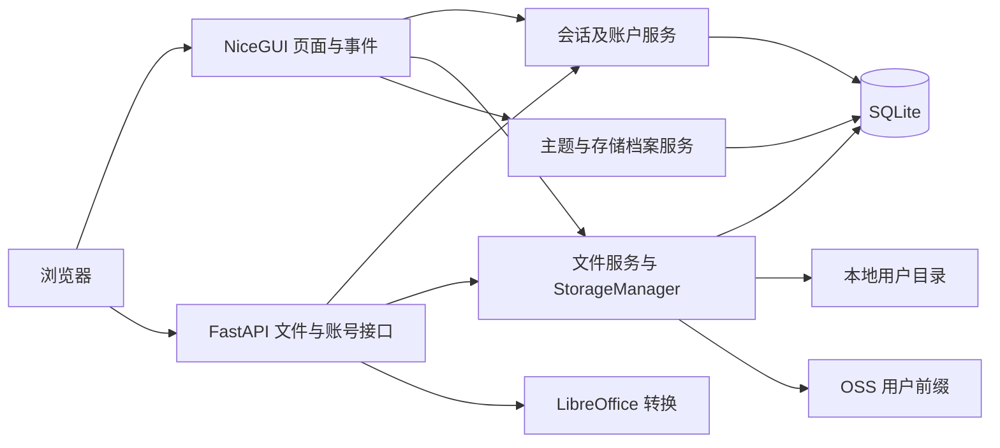

# 架构

StarDrive 面向自托管个人和小团队。单实例提供隔离的用户文件空间、浏览器预览和临时分享。用户通过 NiceGUI 页面操作，管理员通过 Console 管理账户、主题、服务地址和存储档案。应用采用 Python 3.12、uv、NiceGUI/FastAPI、SQLModel、SQLite/Alembic、Babel，存储支持本地磁盘和阿里云 OSS。

- **引导**。 `app/main.py` 配置 NiceGUI 并启动单进程。 `app/bootstrap/` 装配页面、API 路由、中间件、静态资源和启动任务。启动依次迁移数据库、载入主题与存储档案、初始化用户管理。 `/api/healthz` 表示 HTTP 存活。
- **信任边界**。 `AuthLoggingMiddleware` 初筛页面。 `require_user` 回查账户状态及会话版本。公开 API 和分享令牌的授权边界按入口验收。NiceGUI 的页面回调同样是服务端入口，必须单独核对事件权限。
- **数据流**。 `FileBrowserTable` 和各对话框调用 `StorageManager`。两种驱动使用同一虚拟路径接口，默认本地根为 `app_data/storage/users/<id>`，OSS 根为 `<prefix>/users/<id>/`。数据库保存用户、档案、主题和下载记录。文件字节由后端负责，OSS 大文件上传使用临时盘。
- **配置边界**。连接配置的秘密由 `APP_SECRET` 派生密钥加密。相同密钥还支撑 NiceGUI 会话和签名链接。NiceGUI 的 general storage 持久化 Service URL，数据库持久化活跃存储档案。切换影响新建的 StorageManager，已打开页面可能继续持有旧对象。
- **部署约束**。应用状态、会话和存储配置含进程内状态，当前运行边界为单副本。前置代理应支持 WebSocket。日志、预览缓存、SQLite、本地文件与 NiceGUI 数据目录均需要容量与权限边界。

扩展存储前先跑同一组路径隔离、错误分类、流式读写、空目录、范围读取和取消契约测试。保持 UI 调度、存储驱动与数据库事务的现有边界，优先提取已经重复且风险明确的行为。架构决策见 [ADR-0001](DECISIONS/0001-single-instance.md)。
